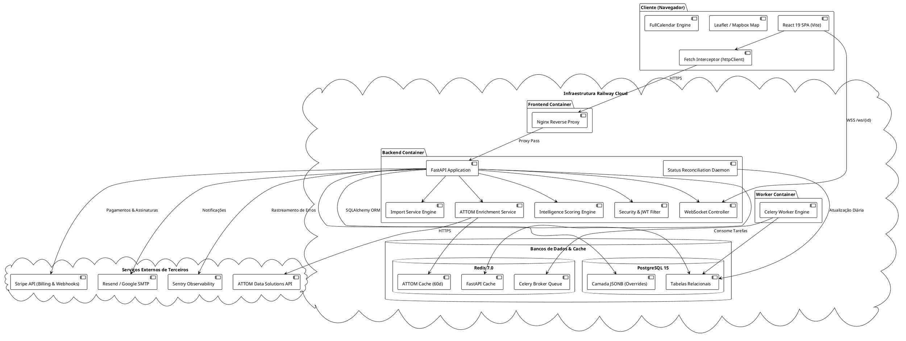
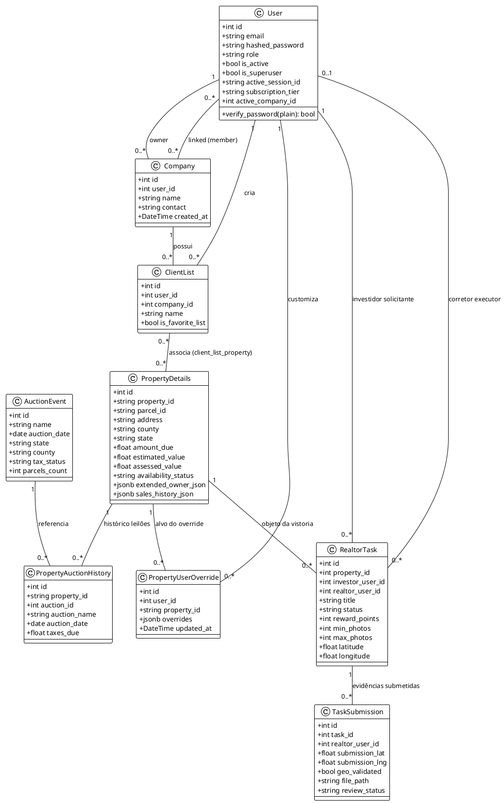
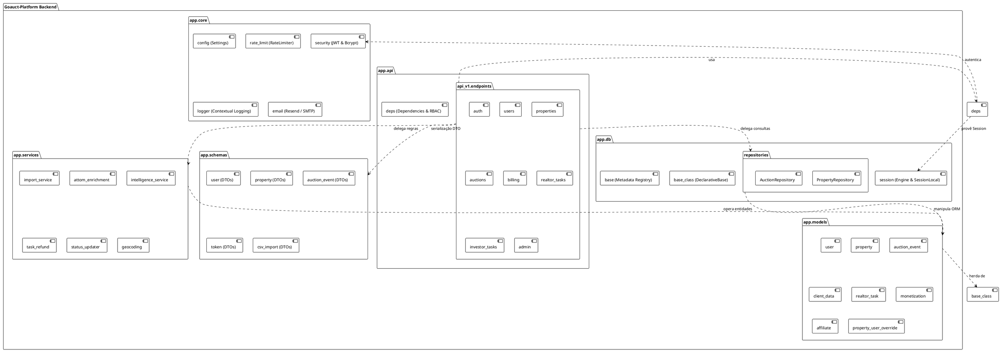
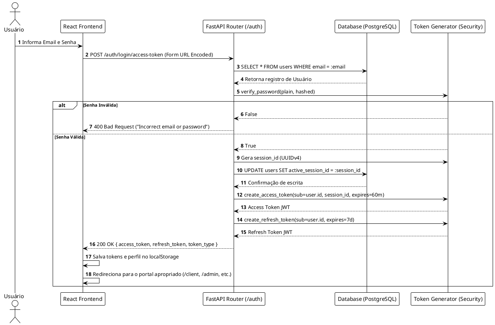
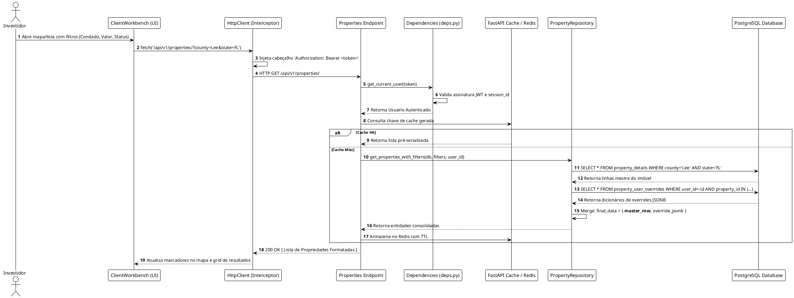
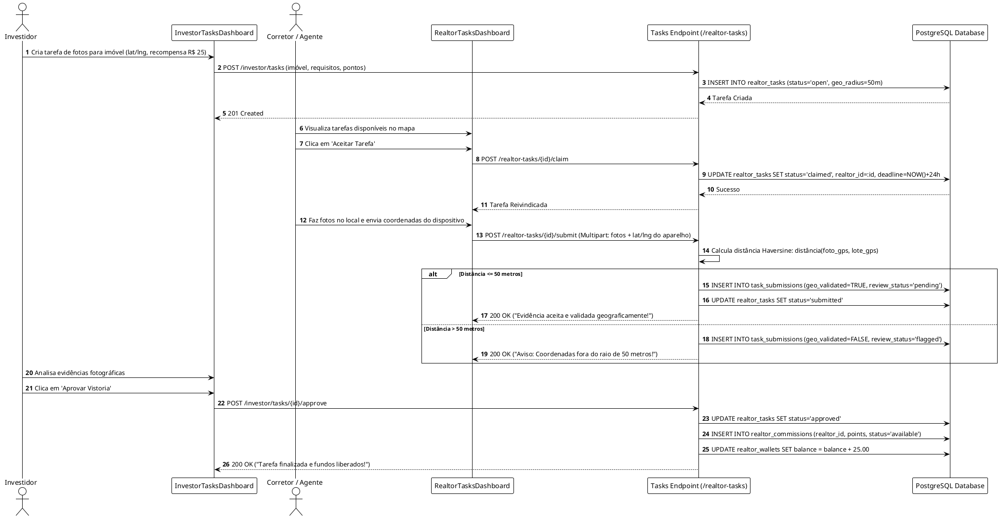
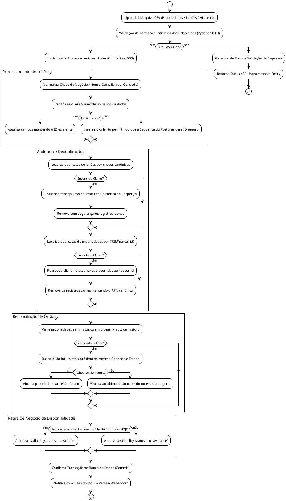
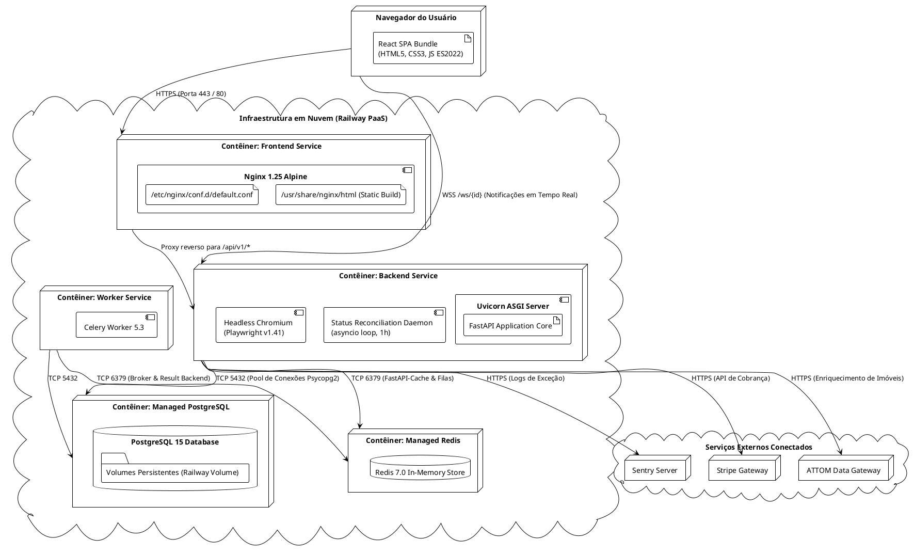
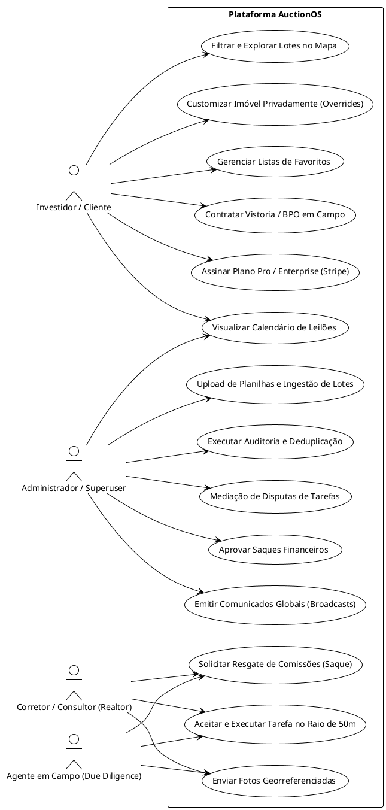

# Especificação Técnica Arquitetural & Modelagem UML
## Goauct Platform (AuctionOS)

> **Documento Gerado por:** Staff Software Engineer, Tech Lead & Enterprise Software Architect  
> **Status:** Concluído / Auditado contra o Código-Fonte  
> **Escopo da Análise:** 100% dos módulos do repositório `Goauct-Platform` (Front-end, Back-end, Banco de Dados, Infraestrutura, Pipelines Assíncronos)

---

## 1. Visão Geral da Arquitetura & Paradigma

O **Goauct-Platform** (conhecido comercial e tecnicamente como **AuctionOS**) é uma plataforma SaaS distribuída de inteligência imobiliária, gestão de leilões fiscais e judiciais (*tax deed, tax lien, foreclosure*) e economia colaborativa de vistorias (*due diligence* em campo).

### 1.1 Estilo Arquitetural
* **Padrão Primário:** **Modular Monolith com Frontend SPA Desacoplado** e **Worker Assíncrono Orientado a Eventos/Filas**.
* **Frontend:** Single Page Application (SPA) reativa desenvolvida em React 19 e Vite, servida estaticamente por contêiner Nginx com proxy reverso e roteamento baseado em hash (`HashRouter`).
* **Backend:** API RESTful assíncrona de alta performance desenvolvida em Python 3.12 com FastAPI, Starlette e Pydantic v2.
* **Processamento em Background:** Celery 5.3 com Redis 7.0 para agendamentos periódicos (*Celery Beat*), reconciliação de dados, tarefas de raspagem e liquidação financeira de vistorias.
* **Camada de Persistência:** PostgreSQL 15 com suporte a PostGIS, SQLAlchemy 2.0 ORM e migrações versionadas com Alembic aliadas a migrações em tempo de inicialização (*safe runtime DDL*).
* **Camada de Cache & Streaming:** Redis 7.0 (FastAPI-Cache2, cache de requisições externas ATTOM, locks de concorrência) e WebSockets (`/ws/{user_id}`) para notificações em tempo real.
* **Padrão de Dados Multi-Tenant:** Isolamento lógico de dados de investidores e empresas utilizando o padrão **Sparse JSONB Override/Merge** na tabela `property_user_overrides`.

---

## 2. Separação de Camadas & Responsabilidades

O sistema é estritamente estruturado em camadas lógicas para garantir separação de preocupações (*Separation of Concerns - SoC*), facilidade de teste e manutenibilidade:

```
┌────────────────────────────────────────────────────────────────────────┐
│                   PRESENTATION LAYER (Frontend SPA)                    │
│   React 19, Vite, MUI/Emotion, Lucide Icons, Leaflet/Mapbox, Contexts  │
└───────────────────────────────────┬────────────────────────────────────┘
                                    │ HTTPS / WSS (REST API / WebSockets)
┌───────────────────────────────────▼────────────────────────────────────┐
│                  API & GATEWAY LAYER (FastAPI Backend)                 │
│  - Middlewares: ProxyHeaders, CORSMiddleware, Session, RequestLog/CSP   │
│  - Security Pipeline: OAuth2 Password Bearer, JWT HS256, Session Audit  │
│  - Routers (/api/v1/*): Auth, Properties, Auctions, Billing, Tasks...   │
└───────────────────────────────────┬────────────────────────────────────┘
                                    │
┌───────────────────────────────────▼────────────────────────────────────┐
│                    APPLICATION & USE CASES LAYER                       │
│  - Services: ImportService, AttomEnrichment, Intelligence, Geocoding   │
│  - Business Rules: Validação de Raio GPS (50m), Reconciliação Leilões   │
│  - Background Pipelines: Celery Worker Tasks, Status Updater Daemon    │
└───────────────────────────────────┬────────────────────────────────────┘
                                    │
┌───────────────────────────────────▼────────────────────────────────────┐
│                       DOMAIN & REPOSITORY LAYER                        │
│  - Repositories: PropertyRepository, AuctionRepository                 │
│  - Domain Entities: User, PropertyDetails, AuctionEvent, RealtorTask...│
│  - Data Transfer Objects (DTOs): Pydantic Schemas (Input/Output)       │
└───────────────────────────────────┬────────────────────────────────────┘
                                    │ SQLAlchemy 2.0 ORM / Psycopg2
┌───────────────────────────────────▼────────────────────────────────────┐
│                   PERSISTENCE & INFRASTRUCTURE LAYER                   │
│  - PostgreSQL 15 (Tabelas Relacionais, JSONB, Índices Únicos)           │
│  - Redis 7.0 (Cache TTL 60d, Celery Broker, Session Tracking)          │
│  - AWS S3 / Disco Local (Uploads, Mídias, Relatórios PDF)              │
│  - Gateways Externos: Stripe (Billing), ATTOM API, Resend / SMTP       │
└────────────────────────────────────────────────────────────────────────┘
```

---

## 3. Front-End: Análise Profunda

### 3.1 Stack Tecnológico
* **Framework Core:** React 19.2.4 com TypeScript 5.8.2.
* **Bundler & Build Tool:** Vite 6.2.0.
* **Roteamento:** React Router DOM 7.13.0 utilizando `HashRouter`.
* **Componentes de UI & Estilização:** Material-UI (MUI v7), `@emotion/react`, `@emotion/styled`, Tailwind CSS v3 e ícones vetoriais `lucide-react`.
* **Mapeamento & Visualização Geoespacial:** Leaflet 1.9, React-Leaflet 5.0, Mapbox GL 3.18, `react-usa-map`, `react-simple-maps`, `d3-scale`.
* **Gráficos & Dashboards:** Recharts 3.7.0.
* **Calendário de Leilões:** `@fullcalendar/react` 6.1.20 (DayGrid, TimeGrid, Interaction, List).
* **Internacionalização:** Sistema de dicionários JSON nativo (`/locales/en.json`, `/locales/pt.json`) orquestrado pelo `LanguageContext`.

### 3.2 Estrutura Modular de Pastas
```
frontend/
├── components/          # Componentes reutilizáveis de interface
│   ├── admin/           # Calendários, tabelas e modais administrativos
│   ├── client/          # Workbench de investidores, filtros e cartões de lote
│   ├── common/          # Componentes genéricos (Botões, Inputs, Modais)
│   ├── map/             # Visualizadores Leaflet, Street View e camadas GIS
│   └── Layout.tsx       # Shell de navegação do painel administrativo
├── context/             # Gerenciamento de estado global via React Context
│   ├── AuthContext.tsx      # Sessão de usuário, perfil e tokens JWT
│   ├── CompanyContext.tsx   # Empresa ativa selecionada (multi-tenant)
│   ├── LanguageContext.tsx  # Idioma ativo e função de tradução (t)
│   └── TourContext.tsx      # Guia interativo passo a passo para novos usuários
├── layouts/             # Modelos de estrutura de página
│   ├── ClientLayout.tsx     # Shell com sidebar, header e badge do portal do investidor
│   └── PublicLayout.tsx     # Cabeçalho e rodapé das páginas públicas de landing e preços
├── pages/               # Controladores de visão associados a rotas
│   ├── admin/           # Gestão de leilões, usuários, listas, importadores e saques
│   ├── agent_due_diligence/ # Portal de agentes de vistoria e histórico de retiradas
│   ├── client/          # Workbench, pesquisa de imóveis, listas salvas e faturamento
│   ├── public/          # Landing pages: Home, Pricing, Suporte, Termos
│   └── realtor/         # Painel de corretores, tarefas de BPO e comissões
├── services/            # Clientes de comunicação HTTP e abstração de endpoints
│   ├── httpClient.ts    # Instância base, cabeçalhos, interceptor de 401 e logout
│   ├── auth.service.ts  # Login OAuth2, Refresh Token e dados do usuário logado
│   ├── property.service.ts # Consultas paginadas, filtros e overrides
│   ├── auction.service.ts  # Calendário de eventos e favoritos
│   └── realtor_task.service.ts # Fluxo de BPO e upload de evidências
└── types.ts             # Tipagens de domínio compartilhadas em TypeScript
```

### 3.3 Gestão de Estado & Fluxo de Navegação
O estado global da aplicação é distribuído em contextos com escopos bem delimitados:
1. `AuthContext`: Mantém a identidade do usuário, tokens (`token`, `refresh_token`), papel funcional (`role`) e estado de expiração de trial (`trial_expired`).
2. `CompanyContext`: Gerencia a empresa ativa para investidores corporativos, injetando o cabeçalho/parâmetro `company_id` nas requisições.
3. `LanguageContext`: Fornece a função reativa `t(key)` para tradução imediata em tempo de renderização.

#### Os 4 Portais da Aplicação (RBAC no Frontend):
A rota `<ProtectedRoute>` intercepta cada navegação e valida a sessão do usuário em `localStorage`:
* **Portal Administrativo** (`/dashboard`, `/admin/*`): Exclusivo para usuários com papéis `admin` e `superuser`.
* **Portal do Investidor / Cliente** (`/client/*`): Para papéis `client`, `manager` e `agent`. Possui barreira automática contra expiração de período de testes (`trial_expired`), forçando o redirecionamento para `/client/expired` ou `/client/billing`.
* **Portal do Corretor / Consultor** (`/realtor/*`): Para corretores credenciados executarem vistorias de BPO.
* **Portal de Due Diligence em Campo** (`/agent/*`): Destinado a agentes de coleta de fotos e verificações presenciais.

---

## 4. Back-End: Análise Profunda

### 4.1 Framework & Configuração Core
* **Framework:** FastAPI 0.109.2 construído sobre Starlette 0.36.3.
* **Configuração:** `pydantic-settings` lendo dinamicamente variáveis de ambiente em `app/core/config.py` com validação de tipos rigorosa.
* **Ponto de Entrada:** `app/main.py` contendo o ciclo de vida da aplicação (`lifespan`), registro de middlewares, montagem de rotas e rotas WebSocket.

### 4.2 Pipeline de Middlewares & Segurança
1. **`ProxyHeadersMiddleware`**: Configurado com `trusted_hosts="*"`, assegurando que o IP real e o protocolo HTTPS sejam reconhecidos quando executado atrás do balanceador de carga do Railway.
2. **`SessionMiddleware`**: Gerencia cookies assinados com `SECRET_KEY` para o fluxo de autenticação social (Google/Facebook OAuth).
3. **`CORSMiddleware`**: Configurado com suporte a domínios de desenvolvimento local e expressões regulares de produção (`goauct.com`, `auctionos.com` e subdomínios `up.railway.app`).
4. **`log_requests` HTTP Middleware**:
   * Gera um `request_id` (UUIDv4) para cada ciclo de requisição/resposta, armazenado em `contextvars` para rastreamento de logs estruturados.
   * Adiciona cabeçalhos corporativos de proteção contra ataques (*Defense-in-Depth*):
     * `X-Content-Type-Options: nosniff`
     * `X-Frame-Options: DENY`
     * `X-XSS-Protection: 1; mode=block`
     * `Strict-Transport-Security: max-age=31536000; includeSubDomains`
     * `Content-Security-Policy (CSP)` restritiva.

### 4.3 Autenticação, Autorização e Auditoria de Sessão
A segurança é centralizada em `app/api/deps.py` e `app/core/security.py`:
* **Tokens JWT:** Assinados com algoritmo HS256 utilizando chave simétrica `SECRET_KEY`.
  * **Access Token:** Duração padrão configurada para 60 minutos.
  * **Refresh Token:** Duração estendida de 7 dias, armazenado de forma protegida para renovação contínua de credenciais via endpoint `/api/v1/auth/refresh`.
* **Mecanismo Anti-Concorrência de Dispositivos (*Single-Session Enforcement*):**
  * O modelo `User` possui a coluna `active_session_id`.
  * Ao fazer login, uma nova sessão (UUID) é gravada no banco e injetada no payload JWT (`session_id`).
  * Em cada requisição protegida (`get_current_user`), o sistema verifica se `token_data.session_id == user.active_session_id`.
  * Caso o usuário conecte-se em outro dispositivo, a sessão anterior é invalidada com código `401 Unauthorized` e detalhe `"session active in another device"`.

### 4.4 Serviços de Negócio Principais
* **`ImportService` (`app/services/import_service.py`):** Motor de ingestão em lote de arquivos CSV para propriedades, leilões e histórico, operando com lotes de 500 linhas em transações atômicas com tratamento de reconexão de rede.
* **`AttomEnrichmentService` (`app/services/attom_enrichment.py`):** Integração com a API gateway da ATTOM Data Solutions. Implementa cache no Redis com TTL de 60 dias e política de tentativas automáticas com recuo exponencial (*tenacity*). Enriquecimento de proprietários, histórico de vendas, impostos e licenças.
* **`IntelligenceService` (`app/services/intelligence_service.py`):** Algoritmo heurístico de classificação de negócios imobiliários (*Motor Score / Deal Score* de 0 a 100) baseado na razão imposto devido versus valor avaliado (*ratio*), verificação cadastral e tipo de venda (Tax Lien vs Tax Deed).
* **`TaskRefundService` (`app/services/task_refund.py`):** Rotina automática que monitora tarefas de due diligence expiradas ou não atendidas, devolvendo créditos de custódia (*escrow*) aos investidores.

---

## 5. Banco de Dados: Modelagem Relacional & Esquema

O banco de dados relacional é mantido em PostgreSQL 15. A seguir, o catálogo formal das tabelas mapeadas no ORM (`app/models/`):

### 5.1 Catálogo de Tabelas
| Nome da Tabela | Entidade ORM | Chave Primária | Chaves Estrangeiras Principais | Descrição & Responsabilidade |
| :--- | :--- | :--- | :--- | :--- |
| **`users`** | `User` | `id` (SERIAL) | `company_id`, `active_company_id`, `created_by_id` | Identidades, credenciais, planos e controle de sessão. |
| **`property_details`** | `PropertyDetails` | `id` (SERIAL) | `company_id`, `created_by_user_id` | Mestre de propriedades (APN, coordenadas, valores, ATTOM). |
| **`auction_events`** | `AuctionEvent` | `id` (SERIAL) | — | Calendário de leilões fiscais e judiciais por condado/estado. |
| **`property_auction_history`** | `PropertyAuctionHistory` | `id` (SERIAL) | `auction_id` -> `auction_events.id` | Vínculos relacionais entre propriedades e leilões. |
| **`property_availability_history`**| `PropertyAvailabilityHistory`| `id` (SERIAL) | — | Auditoria de mudanças de disponibilidade (*available* / *unavailable*). |
| **`property_user_overrides`** | `PropertyUserOverride` | `id` (SERIAL) | `user_id`, `property_id` | Customizações privadas de propriedades via Sparse JSONB. |
| **`property_scores`** | `PropertyScore` | `parcel_id` (VARCHAR) | — | Classificação de atratividade de investimentos (Score & Rating). |
| **`companies`** | `Company` | `id` (SERIAL) | `user_id` -> `users.id` | Empresas proprietárias para contas corporativas. |
| **`user_company_links`** | `user_company_links` (Table) | `(user_id, company_id)` | `user_id`, `company_id` | Tabela associativa Many-to-Many entre usuários e empresas. |
| **`client_lists`** | `ClientList` | `id` (SERIAL) | `user_id`, `company_id` | Listas salvas de imóveis favoritas de investidores. |
| **`client_list_property`** | `client_list_property` (Table) | `(list_id, property_id)` | `list_id`, `property_id` | Associação N:N entre listas de clientes e propriedades. |
| **`client_notes`** | `ClientNote` | `id` (SERIAL) | `user_id`, `property_id`, `company_id` | Anotações textuais privadas do investidor sobre o lote. |
| **`client_attachments`** | `ClientAttachment` | `id` (SERIAL) | `user_id`, `property_id`, `company_id` | Documentos, fotos e PDFs anexados a um lote. |
| **`user_favorite_auctions`** | `UserFavoriteAuction` | `(user_id, auction_id)` | `user_id`, `auction_id` | Leilões marcados como favoritos pelo usuário. |
| **`realtors`** | `Realtor` | `id` (SERIAL) | `user_id` -> `users.id` | Perfil de corretores e licenças imobiliárias. |
| **`realtor_tasks`** | `RealtorTask` | `id` (SERIAL) | `property_id`, `investor_user_id`, `realtor_user_id` | Ordens de serviço de verificação presencial (*BPO Task*). |
| **`task_submissions`** | `TaskSubmission` | `id` (SERIAL) | `task_id`, `realtor_user_id` | Evidências fotográficas e coordenadas de validação GPS. |
| **`realtor_commissions`** | `RealtorCommission` | `id` (SERIAL) | `realtor_user_id`, `task_id` | Livro-caixa de comissões ganhas por tarefas concluídas. |
| **`realtor_wallets`** | `RealtorWallet` | `id` (SERIAL) | `realtor_user_id` -> `users.id` | Saldo disponível e histórico de retenções financeiras. |
| **`withdrawal_requests`** | `WithdrawalRequest` | `id` (SERIAL) | `realtor_user_id` | Solicitações de saque de consultores e corretores. |
| **`user_subscriptions`** | `UserSubscription` | `id` (SERIAL) | `user_id` -> `users.id` | Assinaturas ativas no Stripe e cotas de uso do plano. |
| **`storage_usage`** | `StorageUsage` | `id` (SERIAL) | `company_id` -> `companies.id` | Medição de consumo de armazenamento de arquivos em disco. |
| **`notifications`** | `Notification` | `id` (SERIAL) | `user_id` -> `users.id` | Alertas do sistema e notificações de tarefas e leilões. |
| **`activity_logs`** | `ActivityLog` | `id` (SERIAL) | `user_id`, `company_id` | Trilha de auditoria das ações realizadas pelos usuários. |
| **`affiliate_profiles`** | `AffiliateProfile` | `id` (SERIAL) | `user_id` -> `users.id` | Código de rastreamento de afiliados e saldo financeiro. |
| **`affiliate_referrals`** | `AffiliateReferral` | `id` (SERIAL) | `affiliate_id`, `referred_user_id` | Conversões de usuários indicados e comissões pendentes. |
| **`affiliate_withdrawals`**| `AffiliateWithdrawal`| `id` (SERIAL) | `affiliate_id` | Pedidos de repasse de comissões de afiliados. |
| **`county_contacts`** | `CountyContact` | `id` (SERIAL) | — | Telefones, endereços e links oficiais de condados. |
| **`state_contacts`** | `StateContact` | `id` (SERIAL) | — | Dados institucionais e regulatórios por estado norte-americano. |
| **`system_announcements`** | `SystemAnnouncement` | `id` (SERIAL) | `created_by` -> `users.id` | Avisos globais em banner para todos os clientes ativos. |
| **`community_updates`** | `CommunityUpdate` | `id` (SERIAL) | — | Postagens e novidades no feed da comunidade da plataforma. |
| **`leads`** | `Lead` | `id` (SERIAL) | — | Capturas de formulários públicos de contato e marketing. |

---

## 6. Infraestrutura, DevOps & Fluxo de Implantação

### 6.1 Plataforma de Hospedagem: Railway Cloud
A infraestrutura em produção é orquestrada na plataforma **Railway**:
1. **Contêiner de Backend:**
   * Construído através de `backend/Dockerfile` utilizando a imagem base multi-estágio da Microsoft: `mcr.microsoft.com/playwright/python:v1.41.0-jammy`.
   * Inicializado pelo script [start.sh](file:///c:/Users/user/Documents/Dev/Projects/Goauct-Platform/backend/start.sh):
     ```bash
     alembic upgrade head
     python3 scripts/ensure_admin.py
     uvicorn app.main:app --host 0.0.0.0 --port ${PORT:-8000}
     ```
2. **Contêiner de Frontend:**
   * Construído via `frontend/Dockerfile` em dois estágios:
     * Estágio 1 (`node:18-alpine`): Instala dependências com `npm install --legacy-peer-deps` e compila com `npm run build`.
     * Estágio 2 (`nginx:alpine`): Copia os arquivos compilados (`/app/dist`) para `/usr/share/nginx/html` e aplica substituição dinâmica da porta da variável `$PORT` do Railway no arquivo de configuração do Nginx.
3. **Contêiner de Banco de Dados:**
   * Instância PostgreSQL 15 com armazenamento persistente em volume de disco montado.
4. **Contêiner de Cache & Filas:**
   * Redis 7.0 em imagem leve `redis:7.0-alpine`.

---

## 7. Diagramas Arquiteturais em PlantUML

Os diagramas abaixo utilizam a sintaxe oficial do PlantUML e estão prontos para renderização em qualquer ferramenta compatível.

### 7.1 Diagrama de Componentes da Aplicação



---

### 7.2 Diagrama de Classes do Domínio Central



---

### 7.3 Diagrama de Pacotes (Arquitetura Modular)



---

### 7.4 Diagramas de Sequência

#### 7.4.1 Fluxo de Autenticação & Auditoria de Sessão Única



#### 7.4.2 Fluxo Completo de Consulta de Propriedades com Merge de Overrides Privados



#### 7.4.3 Ciclo de Vida da Tarefa de Due Diligence (BPO) com Validação GPS



---

### 7.5 Diagrama de Atividades: Ingestão, Deduplicação e Reconciliação



---

### 7.6 Diagrama de Implantação (Deployment Railway)



---

### 7.7 Diagrama de Casos de Uso por Papel



---

### 7.8 Diagrama de Banco de Dados (ER / Modelo Entidade-Relacionamento em PlantUML)

```plantuml
@startuml er_diagram
!theme plain
skinparam linetype ortho

entity "users" as users {
  * id : SERIAL <<PK>>
  --
  * email : VARCHAR(255) <<UNIQUE>>
  * hashed_password : VARCHAR(255)
  * role : VARCHAR(50)
  is_active : BOOLEAN
  is_superuser : BOOLEAN
  active_session_id : VARCHAR(255)
  active_company_id : INTEGER <<FK>>
  company_id : INTEGER <<FK>>
  created_by_id : INTEGER <<FK>>
  subscription_tier : VARCHAR(50)
}

entity "companies" as companies {
  * id : SERIAL <<PK>>
  --
  * user_id : INTEGER <<FK>>
  * name : VARCHAR(255)
  contact : VARCHAR(255)
  created_at : TIMESTAMP
}

entity "user_company_links" as user_company_links {
  * user_id : INTEGER <<PK, FK>>
  * company_id : INTEGER <<PK, FK>>
  --
  role : VARCHAR(50)
}

entity "property_details" as property_details {
  * id : SERIAL <<PK>>
  --
  * property_id : VARCHAR(36) <<UNIQUE>>
  parcel_id : VARCHAR(100) <<UNIQUE>>
  company_id : INTEGER <<FK>>
  created_by_user_id : INTEGER <<FK>>
  address : VARCHAR(255)
  county : VARCHAR(100)
  state : VARCHAR(100)
  amount_due : FLOAT
  estimated_value : FLOAT
  assessed_value : FLOAT
  availability_status : VARCHAR(50)
  extended_owner_json : JSONB
  sales_history_json : JSONB
}

entity "auction_events" as auction_events {
  * id : SERIAL <<PK>>
  --
  * name : VARCHAR(255)
  * auction_date : DATE
  state : VARCHAR(100)
  county : VARCHAR(100)
  tax_status : VARCHAR(100)
  parcels_count : INTEGER
  available_count : INTEGER
}

entity "property_auction_history" as property_auction_history {
  * id : SERIAL <<PK>>
  --
  * property_id : VARCHAR(36) <<FK>>
  auction_id : INTEGER <<FK>>
  auction_name : VARCHAR(255)
  auction_date : DATE
  taxes_due : FLOAT
}

entity "property_user_overrides" as property_user_overrides {
  * id : SERIAL <<PK>>
  --
  * user_id : INTEGER <<FK>>
  * property_id : VARCHAR(36) <<FK>>
  * overrides : JSONB
  updated_at : TIMESTAMP
}

entity "client_lists" as client_lists {
  * id : SERIAL <<PK>>
  --
  * user_id : INTEGER <<FK>>
  company_id : INTEGER <<FK>>
  * name : VARCHAR(255)
  is_favorite_list : BOOLEAN
}

entity "client_list_property" as client_list_property {
  * list_id : INTEGER <<PK, FK>>
  * property_id : INTEGER <<PK, FK>>
}

entity "client_notes" as client_notes {
  * id : SERIAL <<PK>>
  --
  * user_id : INTEGER <<FK>>
  * property_id : INTEGER <<FK>>
  company_id : INTEGER <<FK>>
  * note_text : TEXT
}

entity "client_attachments" as client_attachments {
  * id : SERIAL <<PK>>
  --
  * user_id : INTEGER <<FK>>
  * property_id : INTEGER <<FK>>
  company_id : INTEGER <<FK>>
  file_path : VARCHAR(1000)
  filename : VARCHAR(255)
}

entity "realtor_tasks" as realtor_tasks {
  * id : SERIAL <<PK>>
  --
  * property_id : INTEGER <<FK>>
  investor_user_id : INTEGER <<FK>>
  realtor_user_id : INTEGER <<FK>>
  * title : VARCHAR(255)
  status : VARCHAR(50)
  reward_points : INTEGER
  min_photos : INTEGER
  max_photos : INTEGER
  latitude : FLOAT
  longitude : FLOAT
}

entity "task_submissions" as task_submissions {
  * id : SERIAL <<PK>>
  --
  * task_id : INTEGER <<FK>>
  realtor_user_id : INTEGER <<FK>>
  submission_lat : FLOAT
  submission_lng : FLOAT
  geo_validated : BOOLEAN
  file_path : VARCHAR(2048)
  review_status : VARCHAR(50)
}

entity "user_subscriptions" as user_subscriptions {
  * id : SERIAL <<PK>>
  --
  * user_id : INTEGER <<UNIQUE, FK>>
  plan_type : VARCHAR(50)
  status : VARCHAR(50)
  stripe_customer_id : VARCHAR(255)
  stripe_subscription_id : VARCHAR(255)
}

entity "affiliate_profiles" as affiliate_profiles {
  * id : SERIAL <<PK>>
  --
  * user_id : INTEGER <<UNIQUE, FK>>
  * affiliate_code : VARCHAR(50) <<UNIQUE>>
  status : VARCHAR(50)
  available_balance : FLOAT
}

users ||--o{ companies : "owns"
users ||--o{ user_company_links : "participates"
companies ||--o{ user_company_links : "has members"
users ||--o{ client_lists : "creates"
companies ||--o{ client_lists : "owns"
client_lists ||--o{ client_list_property : "contains"
property_details ||--o{ client_list_property : "belongs to"

property_details ||--o{ property_auction_history : "has"
auction_events ||--o{ property_auction_history : "associated with"

users ||--o{ property_user_overrides : "customizes"
property_details ||--o{ property_user_overrides : "overridden by"

property_details ||--o{ client_notes : "annotated in"
users ||--o{ client_notes : "wrote"

property_details ||--o{ client_attachments : "has files"
users ||--o{ client_attachments : "uploaded"

property_details ||--o{ realtor_tasks : "target of"
users ||--o{ realtor_tasks : "ordered by (investor)"
users ||--o{ realtor_tasks : "assigned to (realtor)"
realtor_tasks ||--o{ task_submissions : "evidenced by"

users ||--|| user_subscriptions : "subscribes"
users ||--o| affiliate_profiles : "is partner"

@enduml
```



---

## 8. Matriz de Linguagens e Tecnologias

| Tecnologia | Onde é Utilizada | Por que foi Utilizada | Qual Problema Resolve | Interações | Dependências |
| :--- | :--- | :--- | :--- | :--- | :--- |
| **Python 3.12** | Backend e Scripts | Produtividade, ecossistema rico em dados e suporte a tipagem moderna. | Elimina boilerplate e acelera processamento de regras analíticas. | Interage com PostgreSQL, Redis e Celery. | Runtime Python padrão. |
| **FastAPI** | Backend Web API | Alta performance com padrão ASGI, geração nativa de OpenAPI e tipagem Pydantic. | Reduz latência de I/O em consultas de mapas e valida requisições automaticamente. | Interage com Starlette, Uvicorn e Routers. | Starlette, Pydantic, Uvicorn. |
| **SQLAlchemy 2.0** | Camada de Dados | ORM enterprise com suporte a queries declarativas, lazy/eager loading e transações seguras. | Abstrai comandos SQL brutos, prevenindo injeções de SQL e garantindo integridade referencial. | Conecta o modelo de domínio ao banco de dados. | `psycopg2-binary`, `greenlet`. |
| **PostgreSQL 15** | Banco de Dados Principal | Banco relacional robusto com suporte nativo a tipos JSONB, índices parciais e extensões GIS. | Permite queries híbridas relacionais e semiestruturadas com integridade ACID. | Persiste todos os modelos e registros da plataforma. | Driver `psycopg2`. |
| **Redis 7.0** | Cache & Filas | Armazenamento chave-valor em memória de altíssima velocidade. | Evita estouro de cota e latência nas APIs da ATTOM e serve de broker assíncrono. | Interage com `FastAPICache`, `AttomEnrichment` e `Celery`. | `redis-py`. |
| **Celery 5.3** | Workers em Background | Framework de execução assíncrona distribuída em filas. | Isola jobs demorados (conciliações, reembolsos, raspagens) da thread principal da API. | Interage com Redis (broker) e PostgreSQL (dados). | `kombu`, `billiard`, `amqp`. |
| **React 19** | Frontend SPA | Biblioteca reativa baseada em componentes com suporte a renderização declarativa. | Criação de interfaces altamente dinâmicas e responsivas com atualização instantânea. | Renderiza toda a interface do usuário no browser. | `react-dom`. |
| **Vite 6.2** | Build & Dev Tool | Ferramenta de build moderna com Hot Module Replacement (HMR) ultrarrápido. | Elimina gargalos de compilação em desenvolvimento e gera bundles enxutos em produção. | Compila código TypeScript, JSX e CSS. | `@vitejs/plugin-react`. |
| **Leaflet & Mapbox** | Componentes de Mapa | Bibliotecas de renderização cartográfica vetorial e raster. | Visualização geoespacial interativa de milhares de parcelas em leilão. | Consome coordenadas da API do backend. | `react-leaflet`, `mapbox-gl`. |
| **FullCalendar** | Calendário de Leilões | Mecanismo de calendário com suporte a visualização mensal, diária e agrupamento de eventos. | Permite navegação temporal intuitiva por datas de leilões fiscais em múltiplos condados. | Consome eventos de `/api/v1/auctions/`. | `@fullcalendar/core`. |
| **Stripe SDK** | Faturamento e Assinaturas | Gateway de pagamentos global seguro compatível com PCI-DSS. | Automatiza cobrança recorrente de planos SaaS e custódia de valores de tarefas. | Interage com endpoints de webhook e checkout. | `stripe>=8.0.0`. |
| **Playwright** | Automação e Raspagem | Driver de automação de navegador Chromium headless. | Captura informações e telas de sites judiciais com renderização JavaScript pesada. | Executado dentro de contêineres Docker. | `playwright-python`. |

---

## 9. Limitações Técnicas, Não-Conformidades e Recomendações

Com base na auditoria estrita do código-fonte:
1. **Tarefas de Scraping em Segundo Plano:** No arquivo `backend/app/tasks.py`, as tarefas `scrape_county_task` e `import_csv_task` retornam respostas simuladas com a mensagem *"Scrape task disabled during architecture simplification"*. O código de raspagem ativo reside atualmente no projeto irmão `Agent-Extrator`.
2. **Ambiente de Testes Unitários:** Embora a pasta `backend/tests/` exista, muitos testes dependem de conexões ativas com o banco ou de variáveis de ambiente configuradas. Recomenda-se a criação de um banco SQLite em memória com fixtures mockadas para testes de regressão em CI/CD.
3. **Escala de Arquivos Estáticos:** Atualmente, anexos de usuários em `client_attachments` são gravados em disco local no contêiner (`/app/uploads`). Em caso de redimensionamento horizontal no Railway com múltiplos contêineres de backend, os uploads locais não serão compartilhados entre instâncias. Recomenda-se migrar 100% dos uploads para o serviço `StorageService` com bucket AWS S3 já suportado na base de código.
